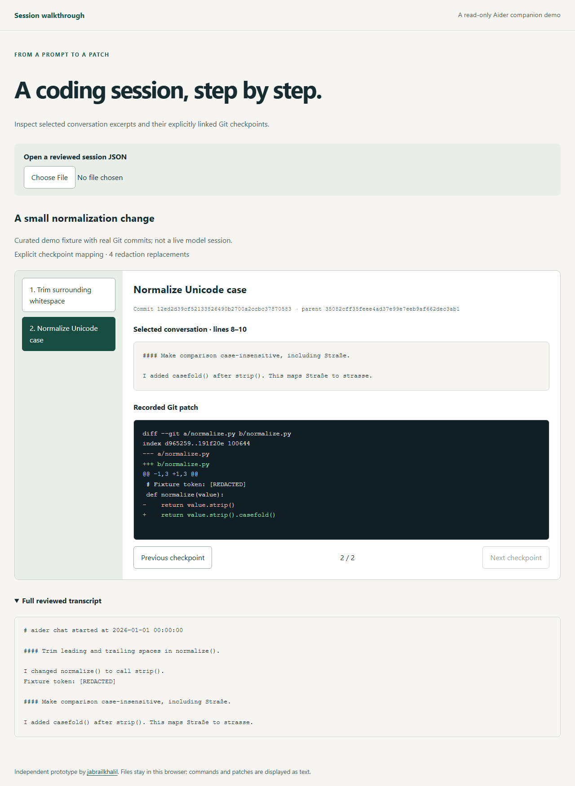

# Aider session walkthrough

I am building an independent, read-only player for studying a coding session.
I use a saved `.aider.chat.history.md` file and explicitly selected Git commits.
I associate conversation line ranges with checkpoints through a small plan;
I do not infer that a particular prompt caused a commit.

I started this after [Aider #5919](https://github.com/Aider-AI/aider/issues/5919).
This prototype is independent of Aider and does not imply upstream endorsement.

[Open the demo](https://jabrailkhalil.github.io/aider-session-walkthrough/).



## Run the demo

```sh
npm ci
npm run build
npm run preview
```

Open the local URL printed by Vite. The bundled example is a curated fixture
with two real Git commits, not a recording of a live model session. I include
the generator in `scripts/make_demo.py`. The player displays literal text:
it does not run commands, apply patches, contact a model, or upload imported files.
After building, serve `dist/` with any local static HTTP server; the assets
require no external CDN. This is not an offline service-worker cache.

## Export another session

I keep preparation and export separate so the complete payload can be reviewed.
The exporter uses Python 3.10+ and Git with `--no-lazy-fetch` support; it has no
runtime Python dependencies. Older Git versions fail the read instead of
silently allowing lazy network fetches.

```sh
python -m pip install -e '.[dev]'
aider-walkthrough prepare --repo /path/to/repo \
  --history /path/to/.aider.chat.history.md --plan plan.json \
  --redact-file redactions.txt --out review.json
```

Example plan (replace the placeholder with a full commit SHA):

```json
{
  "version": 1,
  "title": "My session",
  "provenance": "How and when I recorded this session",
  "checkpoints": [
    {
      "id": "step-1",
      "title": "Explain the change",
      "commit": "FULL_LOWERCASE_COMMIT_SHA",
      "history_lines": [3, 8]
    }
  ]
}
```

`history_lines` is an inclusive, 1-based range in the saved transcript. I normalize
CRLF/CR line endings to LF. A range may include a prompt and its recorded response;
I do not parse Markdown headings as a reliable message or attribution boundary.
The checkpoints appear in the order declared in the plan.

`redactions.txt` contains one nonempty literal per line. Replacements apply to
all string fields, including transcript, selected excerpts, paths in patches and
titles. I do not claim automatic secret discovery. Review the **entire** JSON;
redacted patches are for display and may no longer be applicable Git patches.

After inspecting and, if necessary, editing `review.json`, inspect the current
digest and acknowledge those exact bytes:

```sh
aider-walkthrough inspect --review review.json
aider-walkthrough export --review review.json \
  --ack-sha256 SHA256_FROM_INSPECT --out session.json
```

Open `session.json` in the player's file input. The acknowledgement binds to
the current payload, not to the identity of a reviewer. The digest detects a
content mismatch; it is not an authenticity signature. A later edit needs a new
digest. Keep selected excerpts consistent with the corresponding transcript lines.

## Boundaries

I support up to 50 checkpoints and a 5 MiB payload. I reject merge commits,
abbreviated or option-like commit references, non-UTF-8 history, and oversized
patches (over 2 MiB or 10000 lines). Binary changes appear as Git's textual notice rather than embedded
binary data. I disable external diffs and textconv when reading patches.
I also disable lazy fetching and replacement objects when reading Git objects.
The exporter reads the repository; it does not checkout, reset, stage or commit.
Output creation is exclusive and refuses to overwrite an existing file.

I have not implemented automatic recording, inferred prompt-to-commit links,
command replay, patch application, redaction detection or production deployment.
The browser rejects unknown schema fields, mismatched excerpts and digests.
An export acknowledgement does not establish that any recorded claim is true.

## Checks

```sh
npm run check
npm test
npm run build
npx playwright install
npm run test:browser
python -m ruff check python tests/python scripts
python -m mypy python
python -m pytest -q
python -m build
```

I test the exporter on temporary real Git repositories and the player on built
static assets. I test altered digests, malicious-looking HTML, denied network
requests, redaction, unchanged source repositories and explicit review gates.
Automated accessibility checks do not substitute for testing with actual
assistive-technology users.
